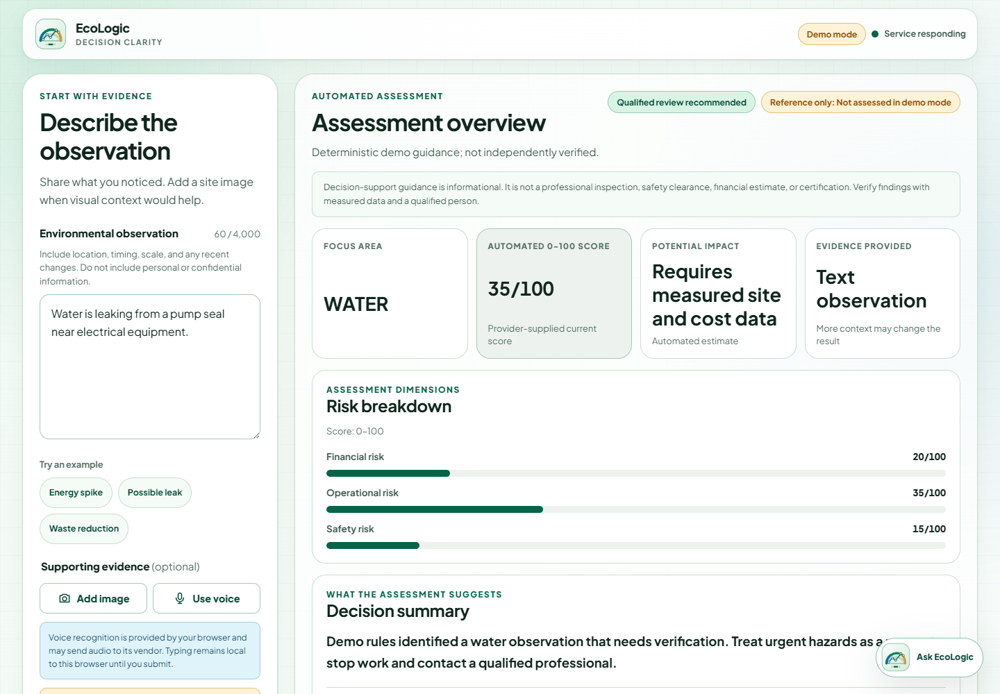
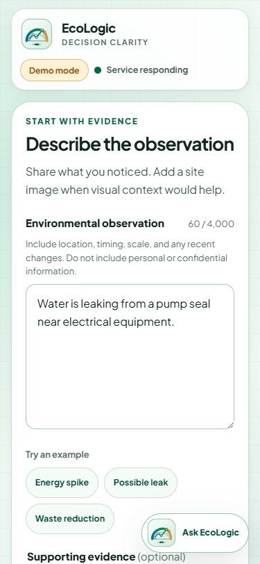
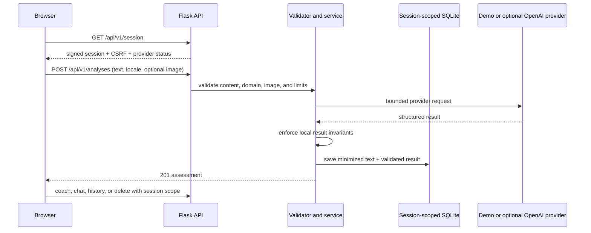

# EcoLogic

**Environmental observations, organized into honest next steps.**

EcoLogic is an environmental decision-support private preview presented and
maintained by **AIONEX**. It turns a written site observation into a structured
focus area, a neutral provider-supplied 0–100 score, contributing factors, and a
six-step review roadmap. The product is designed for facilities, sustainability,
operations, and engineering teams evaluating how a consistent observation
intake workflow could work.

> **Private preview 0.2.0:** the repository is not cleared for public
> proprietary publication or production deployment. Keep it private until the
> credential-rotation, rights, authentication/quota, privacy, and deployment
> gates in [Rights status](docs/RIGHTS_STATUS.md) are complete.



<p align="center">
  
</p>

The screenshots are from the verified local application using synthetic data
and the deterministic demo provider. There is no hosted public demo.

## Why this project exists

Environmental observations often begin as unstructured notes: a leak, an energy
spike, unusual waste, or a possible operating hazard. EcoLogic demonstrates a
review workflow that makes the observation, automated inference, evidence gaps,
and recommended human actions visibly distinct.

The engineering goal is equally important: show how an AI-adjacent product can
fail honestly. Provider outages are errors, not zero-risk results. Demo mode is
clearly identified. Scores are not described as probabilities or forecasts.
Images are not stored. Safety, regulatory, financial, and engineering decisions
remain with qualified people using measured evidence.

## What is implemented

- Text observations in English, Persian, or Arabic script with dynamic direction.
- Optional JPEG, PNG, or WebP evidence up to 2 MB, validated in browser and API.
- Deterministic local demo analysis with no model-provider request.
- Opt-in OpenAI Responses adapter supporting text and image input, strict
  structured output, `store=false`, timeouts, bounded retries, and local
  invariants. It is configuration-compatible but not live-verified here.
- Current score context that displays only the provider-returned value; it does
  not generate a forecast, target, probability, trend, or severity threshold.
- Six-step roadmap with user-controlled local completion state.
- Session-scoped saved history, plain-language Eco-Coach, and follow-up chat.
- Typed versioned API, CSRF, rate limits, security headers, minimized persistence,
  production fail-closed configuration, and structured error envelopes.
- Responsive keyboard-accessible UI with semantic dialogs, focus indicators,
  reduced-motion support, safe text rendering, and no runtime CDN dependency.

## What it is not

EcoLogic is not a site inspection, safety clearance, compliance decision,
certification, diagnosis, calibrated probability, measured risk model, savings
forecast, autonomous controller, or substitute for a qualified professional.
Provider semantics are not independently fact-checked. The private preview has
no user accounts, production SLA, customer deployment, or verified business
outcome.

## Safe quick start

Requirements: Python 3.12 and Node.js only for the JavaScript syntax check.

Clone the authorized private repository, then run from the source checkout.
Do **not** use `pip install .`; the project is intentionally not packaged as a
wheel because its templates and static assets are source-tree resources.

### Windows PowerShell

```powershell
py -3.12 -m venv .venv
.\.venv\Scripts\python.exe -m pip install pip==26.1.2
.\.venv\Scripts\python.exe -m pip install -r requirements.lock
Copy-Item .env.example .env
.\.venv\Scripts\python.exe app.py
```

### macOS or Linux

```bash
python3.12 -m venv .venv
./.venv/bin/python -m pip install pip==26.1.2
./.venv/bin/python -m pip install -r requirements.lock
cp .env.example .env
./.venv/bin/python app.py
```

Open <http://127.0.0.1:5000>. The checked-in example defaults to
`ECOLOGIC_PROVIDER=demo`; no OpenAI request is required.

`requirements.lock` records the exact Python 3.12 runtime versions validated for
this release. It is version-locked, not artifact-hash locked. Use
`requirements.txt` only when deliberately resolving a refreshed environment,
then regenerate both lock files and re-run the audit.

## Configuration

Start from [.env.example](.env.example). Local `.env` files are ignored.

| Variable | Safe default | Purpose |
|---|---|---|
| `ECOLOGIC_PROVIDER` | `demo` | `demo` or opt-in `openai` |
| `ECOLOGIC_DATABASE` | `instance/ecologic.sqlite3` | Local SQLite path |
| `ECOLOGIC_HISTORY_RETENTION_DAYS` | `30` | Activity-triggered local retention |
| `ECOLOGIC_SECRET_KEY` | ephemeral in development | Session signing; required in production |
| `ECOLOGIC_SECURE_COOKIES` | `false` locally | Must be `true` behind production HTTPS |
| `ECOLOGIC_TRUSTED_HOSTS` | unset locally | Required comma-separated production hosts |
| `OPENAI_API_KEY` | unset | Required only for experimental OpenAI mode |
| `OPENAI_MODEL` | `gpt-4o` | Configurable provider model |

Production startup rejects unknown environments, an ephemeral or shorter-than-
32-byte secret, insecure cookies, or missing trusted hosts. The length gate does
not measure entropy: generate a cryptographically random value (for example,
`python -c "import secrets; print(secrets.token_urlsafe(48))"`) and inject it
through a secrets manager. These checks do not replace a correct HTTPS reverse
proxy, authentication, shared quotas, monitoring, backups, or incident response. See the
[security model](docs/SECURITY_MODEL.md).

## Principal flow



In demo mode the provider step is deterministic local code. In OpenAI mode,
text/image/context and a pseudonymous safety identifier cross the external
provider boundary; read [PRIVACY.md](PRIVACY.md) before enabling it.

## API surface

Every JSON response contains `api_version`. Errors use
`{error: {code, message, request_id, details?}}` with an appropriate non-2xx
status. All mutations require `X-CSRF-Token` from the session response.

| Method | Route | Purpose |
|---|---|---|
| GET | `/api/v1/session` | CSRF token and truthful provider status |
| GET | `/api/v1/health` | Local database/provider configuration health; no provider network call |
| POST | `/api/v1/analyses` | Validate, assess, and save one environmental observation |
| GET | `/api/v1/history` | List current anonymous session records |
| DELETE | `/api/v1/history/:id` | Delete one current-session record |
| DELETE | `/api/v1/history` | Clear current-session records |
| POST | `/api/v1/coach` | Explain a saved validated assessment |
| POST | `/api/v1/chat` | Ask a bounded follow-up grounded in a saved assessment |

The detailed contract and failure behavior are in
[Technical deep dive](docs/TECHNICAL_DEEP_DIVE.md).

## Validation evidence

The release gate was run in an isolated Python 3.12 environment with demo mode
and a synthetic non-secret key. No live model request was made.

| Gate | Result |
|---|---|
| pytest | 25 passed |
| Ruff lint | passed |
| Ruff format check | Passed; 16 project Python files already formatted |
| mypy | 12 source files, no issues |
| Bandit | no finding at configured scope |
| pip check | no broken requirements |
| pip-audit | no known vulnerability after upgrading validation pip to 26.1.2 |
| JavaScript syntax | passed |
| SVG XML | passed |
| Real HTTP journey | root/session/health 200; CSRF 403; analyses 201; unsupported topic 422; coach/chat/history/delete passed |
| Browser journey | desktop/mobile assessment, score context, roadmap, history restore, coach, and chat passed |
| Responsive widths | 375, 768, 1024, and 1440 CSS-pixel rules reviewed; live 375/1440 runs had no horizontal overflow |

Run the complete local gate:

```powershell
.\.venv\Scripts\python.exe -m pip install -r requirements-dev.lock
.\.venv\Scripts\python.exe -m pytest -q
.\.venv\Scripts\python.exe -m ruff check .
.\.venv\Scripts\python.exe -m ruff format --check .
.\.venv\Scripts\python.exe -m mypy
.\.venv\Scripts\python.exe -m bandit -q -r app.py wsgi.py ecologic
.\.venv\Scripts\python.exe -m pip_audit -r requirements.lock --no-deps --disable-pip --progress-spinner off
node --check static/script.js
```

## Engineering highlights

- [Architecture](docs/ARCHITECTURE.md) — boundaries, runtime topology, and data flow.
- [Technical deep dive](docs/TECHNICAL_DEEP_DIVE.md) — validation invariants,
  provider contract, persistence, and failure semantics.
- [Security model](docs/SECURITY_MODEL.md) — threat/control matrix and production gates.
- [User flows](docs/USER_FLOWS.md) — primary, alternate, and failure journeys.
- [Architecture decisions](docs/DECISIONS/README.md) — demo-first provider,
  session-scoped minimization, and typed versioned API decisions.
- [Case study](docs/CASE_STUDY.md) — baseline defects, transformation, and lessons.
- [Client adaptation ideas](docs/CLIENT_ADAPTATION_IDEAS.md) — opportunities,
  clearly separated from implemented features.

## Repository map

```text
app.py / wsgi.py           Local and WSGI entry points
ecologic/                  Factory, routes, schemas, providers, services,
                           persistence, security, errors, and rate limits
templates/ + static/       Accessible server-rendered UI and original SVG mark
tests/                     API, service, persistence, and security regressions
docs/                      Architecture, ADRs, case study, flows, and release docs
.github/                   Least-privilege CI, Dependabot, and contribution forms
```

## Privacy, security, and deletion

Successful local history stores only a normalized 500-character observation
prefix plus validated result metadata; images, coach replies, and chat turns are
not written to SQLite. Selected images/retry payloads remain in page memory until
removed or reloaded. Anonymous history is browser-session scoped, not account
authenticated. Deletion cannot promise erasure from backups or external
provider/browser-vendor logs.

Read [PRIVACY.md](PRIVACY.md), [SECURITY.md](SECURITY.md), and the
[security model](docs/SECURITY_MODEL.md) before any deployment.

## Rights and licensing

No public application-source license is granted while original chain-of-title
and possible team/employer/client/competition rights remain unverified. The
repository must stay private. The root [LICENSE](LICENSE) is an interim
private-evaluation notice, not an exclusive AIONEX ownership claim.

Plus Jakarta Sans remains under the SIL Open Font License 1.1. Dependency and
font attributions are in [THIRD_PARTY_NOTICES.md](THIRD_PARTY_NOTICES.md).
Before changing visibility, complete [Rights status](docs/RIGHTS_STATUS.md),
revoke the exposed legacy credential, and approve the final proprietary notice.

## Project status and next steps

The executable private-preview baseline is complete. The next responsible step
is not a public marketing launch: it is written rights clearance, credential
rotation, deployment-specific access/cost/privacy controls, artifact-hash locks,
and an independent production review. See [ROADMAP.md](ROADMAP.md).

EcoLogic is presented and maintained as an AIONEX project. That brand statement
does not override contributor, third-party, or underlying ownership rights.
