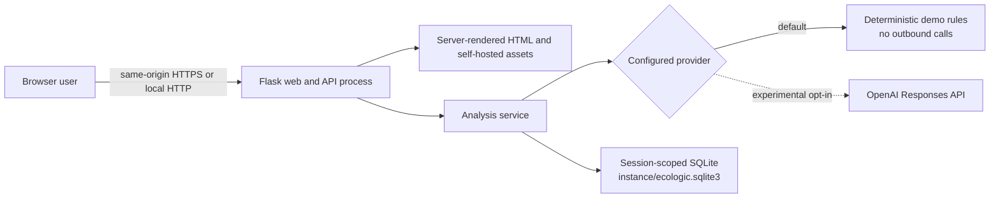
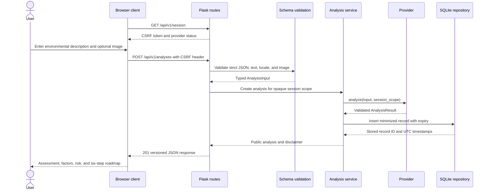

# AIONEX EcoLogic architecture

> Version scope: v0.2.0 private preview. This document describes the code in this repository, not a hosted production service.

EcoLogic is an environmental decision-support web application presented and maintained by AIONEX. It accepts a required written environmental observation and optional image evidence, produces a structured assessment, and keeps a short session-scoped history. The default provider is deterministic demo logic and makes no backend network requests.

## System context

The dashed OpenAI path is not active by default. It requires explicit configuration and has not been live-verified for this private preview.

## Runtime components

| Component | Primary files | Responsibility |
| --- | --- | --- |
| Entrypoints and factory | `app.py`, `wsgi.py`, `ecologic/__init__.py` | Load local configuration, construct the Flask app, initialize dependencies, and enforce production gates. |
| HTTP boundary | `ecologic/routes.py`, `ecologic/errors.py` | Expose the versioned JSON API, compatibility aliases, typed failures, and truthful health output. |
| Request and result contracts | `ecologic/schemas.py` | Reject unknown fields, validate text and image input, validate provider output, and enforce risk invariants. |
| Application service | `ecologic/services.py` | Coordinate provider calls and session-scoped persistence; assemble public response objects. |
| Providers | `ecologic/providers.py` | Supply deterministic demo behavior or the opt-in OpenAI Responses adapter behind one interface. |
| Persistence | `ecologic/database.py` | Store minimized, expiring assessment records in a new SQLite database under `instance/`. |
| Request security | `ecologic/security.py`, `ecologic/rate_limit.py` | Create opaque session scopes, enforce CSRF, apply security headers, and provide a bounded local rate brake. |
| Browser client | `templates/index.html`, `static/script.js`, `static/style.css` | Collect observations, render validated results, manage coach/chat/history interactions, and expose accessible status/error states. |

## Request path

All mutation routes require the session CSRF token. The API derives storage scope from the signed browser session; callers cannot select another session scope in request JSON.

## Canonical API surface

The product release is v0.2.0; the JSON contract independently reports `api_version: "1.0"`.

| Method and route | Purpose | Main payload/result |
| --- | --- | --- |
| `GET /api/v1/session` | Establish signed session state | CSRF token and provider status |
| `GET /api/v1/health` | Side-effect-free readiness | database/provider components, retention, and unverified-live flag |
| `POST /api/v1/analyses` | Create and store an assessment | required `text`, optional `locale` and validated `image.data_url`; returns `analysis` with ID |
| `GET /api/v1/history` | List recent current-session records | optional bounded `limit`; returns `items` |
| `DELETE /api/v1/history/{id}` | Delete one current-session record | typed success or indistinguishable session-scoped not-found |
| `DELETE /api/v1/history` | Clear current-session records | deleted row count |
| `POST /api/v1/coach` | Explain a stored assessment | `analysis_id`; returns bounded `coach` object |
| `POST /api/v1/chat` | Ask about a stored assessment | `analysis_id`, message, and optional bounded history; returns `chat` reply |

POST and DELETE calls use `X-CSRF-Token`. Compatibility aliases remain in code for the transition, but `/api/v1` is the documented contract.

## Provider boundary

`AnalysisProvider` defines three operations: `analyze`, `coach`, and `chat`.

- `DemoProvider` is the default. It uses local, explainable keyword and rule logic, produces deterministic output, and does not inspect image pixels. Image evidence therefore requires a written environmental description and on-site verification.
- `OpenAIResponsesProvider` is experimental and opt-in. Before sending anything, it applies the same local environmental text guard. It uses the official Responses API adapter, strict structured JSON, `store=False`, and an opaque safety identifier. Returned JSON is validated again locally.
- Health checks inspect configuration and local readiness only. They do not call OpenAI, and the API always reports `live_provider_verified: false` in this release.

Provider failures return typed `502` or `503` responses without exposing SDK exceptions, credentials, prompts, or response bodies to the browser.

## Persistence and privacy boundary

The repository creates `instance/ecologic.sqlite3`; it does not migrate or modify the legacy root `database.db` file.

Each stored assessment contains:

- an HMAC-derived session scope, never the raw session identifier;
- UTC creation and expiry timestamps;
- at most 500 normalized characters of the submitted description;
- locale and provider metadata;
- category, risk score, and the validated result JSON.

Image bytes and chat turns are not stored by the application. Records expire after 30 days by default and are purged opportunistically during repository activity. Row deletion and SQLite `secure_delete` reduce routine residue, but do not promise forensic erasure from WAL files, backups, filesystem snapshots, or third-party provider logs.

## Security boundaries

- Flask signs the high-entropy session cookie; the cookie is `HttpOnly` and `SameSite=Lax`.
- Mutation routes require a session-bound `X-CSRF-Token`.
- The content security policy permits self-hosted scripts, styles, and fonts; image previews may use `data:` or `blob:` URLs.
- JSON endpoints return `Cache-Control: no-store`, request IDs, MIME sniffing protection, frame denial, and restrictive browser policies.
- Production startup fails closed without the exact `production` environment value, a secret of at least 32 UTF-8 bytes, secure cookies, and a validated nonempty trusted-host list.
- Request bodies, text, decoded image size, chat turns, and output fields are bounded.

The included rate limiter is a bounded, in-memory, per-process control. It helps with accidental bursts during a private preview, but it is not shared across workers and is not production-grade authentication, quota enforcement, denial-of-service protection, or paid-provider cost control. A public deployment needs upstream/shared rate limits and an authorization model.

## Deployment shape

This repository is a clone-and-virtual-environment application. It is not published or tested as an installable Python wheel, so do not use `pip install .`.

For local development, create a virtual environment, install `requirements-dev.txt`, and run `python app.py`. A Linux WSGI deployment can target `wsgi:app` with Gunicorn after satisfying every production configuration gate. Static files are served by Flask in the current private-preview shape; a production topology may place a reverse proxy or static asset service in front of the app.

## Architectural limits in v0.2.0

- There is no user account or organization tenancy model; isolation is browser-session scoped.
- SQLite and the in-memory limiter are suitable for a local/private preview, not a horizontally scaled service.
- Demo scores are deterministic decision-support heuristics, not measurements, predictions, inspections, certifications, or professional conclusions.
- The OpenAI adapter is implemented and mock-tested but has not been live-verified.
- Roadmap completion state and chat transcripts live in browser memory and are not durable records.

See [Technical deep dive](TECHNICAL_DEEP_DIVE.md), [User flows](USER_FLOWS.md), and [architecture decisions](DECISIONS/README.md).
