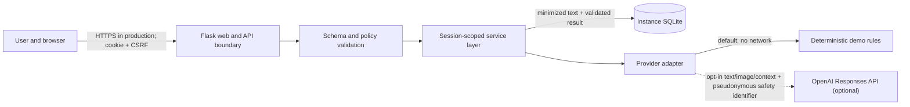

# Security model

- Status: private preview 0.2.0
- Scope: current source tree and local demo deployment
- Last reviewed: 2026-08-08

This model explains implemented boundaries and known limits. It is not a
penetration-test report, compliance certification, or guarantee.

## Assets and trust boundaries

Protected assets are provider credentials, submitted observations and images,
saved excerpts/results, the signed anonymous session, provider cost, and the
integrity of decision-support output.

The browser, Flask process, local database, reverse proxy/host, and optional
provider are separate trust zones. A production operator must secure the zones
outside this repository.

## Request lifecycle

1. `GET /api/v1/session` establishes a signed HTTP-only anonymous session and
   supplies a CSRF token.
2. Mutation routes require that token and a JSON object with a supported
   content type.
3. Local schema validation bounds text, history, image type/size/magic bytes,
   and all provider-result fields. Environmental text is required even when an
   image is attached.
4. The service derives a keyed session scope and applies every history, coach,
   chat, and delete lookup to it.
5. Demo mode executes deterministic local rules. OpenAI mode uses one bounded
   adapter with a timeout, limited retry policy, strict structured output, and
   `store=false`.
6. Only successful, validated analyses are persisted. Provider/config/parse
   failures remain typed non-2xx errors and are not shown or stored as results.

## Session and persistence design

The cookie contains signed session state and is HTTP-only with SameSite=Lax.
Production startup requires secure cookies, a non-ephemeral secret of at least
32 UTF-8 bytes, and validated trusted hosts. A keyed HMAC scope prevents raw
session identifiers from being written to SQLite or sent as the provider safety
identifier.

SQLite statements are parameterized. Connections are explicitly closed.
`secure_delete=ON`, WAL mode, a bounded list limit, and retention cleanup are
enabled. The stored input is normalized and capped at 500 characters; images,
coach replies, and chat turns are not persisted. Deletion and retention cannot
erase host backups or external logs.

## Control matrix

| Threat | Implemented control | Residual risk |
|---|---|---|
| Embedded credential | Environment-only configuration; `.env` ignored; staged secret scan | Original exposed credential still requires provider-side revocation |
| Cross-site mutation | Session-bound CSRF header on every POST/DELETE | XSS or a compromised same-origin deployment could still act as the user |
| Cross-session record access | HMAC session scope in every record query; IDOR tests | Shared browser profiles share the same anonymous session |
| Injection / malformed payload | JSON-only boundary, bounds, image magic bytes, parameterized SQL | Novel parser/library defects remain possible |
| DOM XSS from provider data | `textContent`/element creation; no `innerHTML`, `eval`, inline handlers, or CDN scripts | Browser/runtime vulnerabilities are out of scope |
| Provider outage or malformed result | Typed 502/503, strict schema plus local invariants, no fallback persistence | Live semantic claims are not independently fact-checked |
| Uncontrolled paid usage | Demo default; per-session in-memory limiter | Inadequate for multi-worker/public paid mode; needs shared quotas/auth/gateway |
| Host-header/cookie misconfiguration | Production trusted-host, minimum-secret-length, and secure-cookie startup gates | Secret entropy plus reverse-proxy TLS/Host handling remain operator duties |
| Data over-retention | 500-character local cap, 30-day default, activity-triggered purge, no image/chat persistence | Inactive DBs, backups, provider/browser logs require operator processes |
| Supply-chain drift | Exact version locks, CI lint/test/type/security/audit | Locks lack artifact hashes; third-party compromise remains possible |

## Security headers

API responses use `Cache-Control: no-store`. Responses include a self-only CSP
with a narrow `data:`/`blob:` image exception for local previews, frame and
object denial, content-type sniffing protection, referrer restrictions, and a
permissions policy. Production transport security and HSTS belong at the HTTPS
reverse proxy unless the deployment is configured to emit them correctly.

## Production preconditions

Do not expose OpenAI mode publicly until all of the following exist:

- authenticated users or an equivalent accountable access boundary;
- shared account/IP quotas, gateway enforcement, monitoring, and spend alerts;
- TLS termination, trusted proxy configuration, approved hosts, and secure
  cookies;
- centralized secrets, backup/restore, deletion, and incident procedures;
- deployment-specific privacy notice, consent/legal basis, and provider terms;
- a production datastore and concurrency plan if more than one process writes;
- independent security and accessibility assessment; and
- completed rights/publication clearance.

See the operational variables in `.env.example`, the data disclosures in
`PRIVACY.md`, and the publication gate in `docs/RIGHTS_STATUS.md`.
