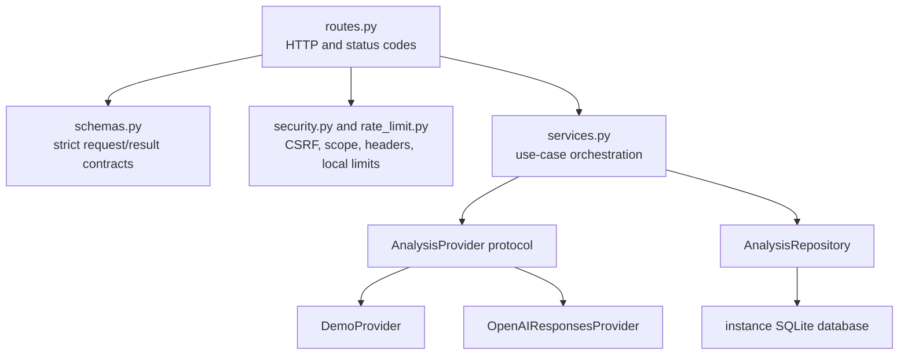

# Technical deep dive

> AIONEX EcoLogic v0.2.0 private preview. Claims here are limited to behavior exercised in the repository. The experimental OpenAI path has not been live-verified.

## Why this code is structured in layers

The application keeps Flask, but separates transport, contracts, orchestration, provider behavior, and persistence. That separation makes the safe default provider deterministic, lets provider responses be treated as untrusted input, and keeps session authorization rules out of browser-controlled JSON.



## Application construction

`create_app()` is the composition root. It:

1. loads conservative defaults and optional test overrides;
2. validates the environment and production-only security requirements;
3. creates the instance directory and initializes a new SQLite schema;
4. chooses `demo` or `openai` explicitly;
5. wires the repository, provider, service, and bounded limiter into Flask extensions;
6. registers typed domain/HTTP handlers, security hooks, and blueprints.

The development and WSGI entrypoints both use the same factory. Debug mode is not enabled by application code. `.env` values are loaded before environment-backed defaults are evaluated and never override already-set process environment variables.

## Strict input boundary

`AnalysisInput.from_mapping` treats client JSON as untrusted:

- the body must be a JSON object;
- unknown keys are rejected;
- a nonempty environmental description is required and capped at 4,000 characters by default;
- locale is inferred as English, Persian, or Arabic when omitted, or normalized from a small language-code form;
- an optional image must be a base64 PNG, JPEG, or WebP data URL;
- declared MIME type, decoded byte signature, and a 2 MB default decoded limit must agree.

Requiring text even with an image is intentional. The local domain guard can inspect text, while demo mode cannot inspect pixels. It also prevents image-only requests from crossing the experimental provider boundary under a false claim that their topic was already classified.

Coach requests contain only `analysis_id`. Chat requests contain `analysis_id`, one bounded message, and up to six bounded user/assistant turns. The stored analysis is loaded by server-derived session scope, so a client cannot replace the authoritative assessment context.

## Result invariants

Provider output is represented as an `AnalysisResult` with a fixed set of fields. A completed analysis must contain:

- `kind: analysis`;
- `analysis_mode: consultation` or `forensic`;
- an integer aggregate risk from 0 through 100;
- exactly three bounded risk components;
- one to five contributing causes;
- exactly six roadmap steps;
- bounded status, explanation, financial-potential, ISO-reference, KPI, and confidence strings.

Mode and risk are coupled:

- consultation means aggregate risk is zero and every risk component is zero;
- forensic means aggregate risk is nonzero and at least one component is nonzero;
- refusal means unknown mode, zero risk, and no causes or roadmap.

These checks prevent contradictory output such as a zero aggregate score with nonzero safety risk. The OpenAI-facing schema uses only the subset of strict Structured Outputs keywords supported by the configured model family; local validation retains the finer string length rules. The integration terminology follows the [official OpenAI Structured Outputs guide](https://developers.openai.com/api/docs/guides/structured-outputs), while the release claims remain limited to the mock-tested adapter in this repository.

## Deterministic demo provider

The default provider is a local rules engine, not a simulated live model call. Its scope guard tokenizes exact terms and uses an explicit stem allowlist for environmental forms such as recycling and sustainability. This avoids substring errors such as matching `air` inside `chair`.

The demo provider then:

1. categorizes the written observation into water, energy, waste, emissions, or general sustainability;
2. distinguishes advisory language from damage/hazard language;
3. assigns a bounded, deterministic risk and consistent component scores;
4. returns two explicit unverified causes and a six-step roadmap;
5. labels financial and ISO fields as unassessed when evidence is unavailable.

Advice produces a zero-risk consultation. Damage terms produce a nonzero forensic review. An attached image can add context to the result, but pixels are not analyzed and an image alone cannot create or raise a finding.

This mode makes local setup predictable and avoids unplanned API cost or third-party data transfer. It must not be described as expert analysis or measured environmental performance.

## Experimental OpenAI adapter

The opt-in adapter uses the official Python SDK and `client.responses.create`. Its analysis call includes:

- the configured model;
- bounded instructions and input items;
- a strict named JSON schema under `text.format`;
- `store=False`;
- the HMAC-derived session scope, truncated to the provider's safety-identifier bound;
- a bounded output token budget.

Text is always included. A validated image data URL is included as `input_image` only when supplied. The adapter never calls the network during construction or health checks. Before a live analysis call, the deterministic local guard rejects empty or out-of-scope descriptions. After a response, JSON parsing and local result validation run before persistence.

Tests use a fake Responses client to verify request shape and failure handling. They do not prove credentials, model availability, latency, provider retention behavior, or end-to-end live compatibility. `store=False` requests that the Responses object not be stored; it is not a promise about all provider security logs or account-level data handling.

## Session scoping and CSRF

The first session request creates a high-entropy browser session ID and CSRF token inside Flask's signed cookie. Database queries do not use the raw session ID. They use:

```text
HMAC-SHA256(application secret, random session ID)
```

The result is an opaque 64-character scope used for row filtering and provider safety identification. Every history read, coach/chat lookup, delete, and clear operation is scoped server-side. Missing records and cross-session IDs both become the same typed `404`, reducing direct-object-reference leakage.

POST and DELETE routes compare `X-CSRF-Token` with the session token using a constant-time comparison. This is session integrity, not user authentication: anyone who controls the browser session controls its private-preview history.

## SQLite design and lifecycle

`AnalysisRepository` owns a schema-versioned SQLite database under the Flask instance directory. Every operation opens a connection through one function and closes it explicitly. Connections enable foreign keys, `secure_delete`, a busy timeout, and `trusted_schema=OFF`; initialization enables WAL and normal synchronous mode.

The `analyses` table stores session scope, UTC timestamps, minimized input, locale/provider metadata, category and risk fields, and compact validated JSON. It deliberately does not store image bytes or chat transcripts. Submitted text is whitespace-normalized and truncated to 500 characters before storage.

Expiry is enforced with a UTC timestamp and a 30-day default retention window. Inserts and reads opportunistically purge expired records. History defaults to ten entries and is capped at fifty at the repository boundary.

Deletion is honest but limited: removing a row is not a cryptographic erase and cannot reach backups, copied files, WAL history, filesystem snapshots, or third-party systems.

## API and failure model

Canonical routes live under `/api/v1`. Successful and failed JSON responses include `api_version`. Failures use this stable shape:

```json
{
  "api_version": "1.0",
  "error": {
    "code": "validation_error",
    "message": "The request did not pass validation.",
    "request_id": "opaque-request-id",
    "details": ["text is too short."]
  }
}
```

Expected failures have explicit status codes: malformed JSON, unsupported media type, validation, CSRF, missing session-owned records, rate limits, provider failure, and unavailable storage/provider. Unexpected exceptions are logged with request ID and exception type; private exception text is not sent to the API client.

The health route reports database readiness, provider configuration readiness, retention, and `live_provider_verified: false`. Selecting OpenAI without a usable key/model/SDK makes readiness degraded; health does not make a verification request.

## Browser rendering and state

The browser uses same-origin `fetch`, obtains a CSRF token before mutations, and renders user/provider strings through text nodes rather than HTML insertion. It exposes:

- provider and service status;
- observation length, image requirements, and demo image disclosure;
- risk, components, causes, confidence, disclaimer, and a current-score context view that explicitly provides no forecast, target, trend, probability, or severity threshold;
- six roadmap checkboxes with in-memory progress;
- a plain-language coach result;
- bounded follow-up chat;
- session history selection and confirmed deletion;
- accessible live regions, dialogs, keyboard behavior, and retry/error states.

Roadmap completion, selected UI state, and chat transcripts are browser-memory state. They are not written to the assessment database.

## Local rate limiter

`BoundedRateLimiter` keeps fixed-window timestamps in a thread-safe, size-bounded ordered map. The default limits are ten analyses per minute, fifteen coach requests per hour, and thirty chat requests per minute, keyed by opaque session scope and operation.

This protects a single process from simple accidental bursts and unbounded key growth. Each worker has independent memory, sessions can be renewed, and there is no identity or billing quota. A public or paid-provider deployment needs shared enforcement—typically at an authenticated API gateway or datastore-backed limiter—and provider-side budget alerts.

## Reproducible development workflow

The project is run from a clone; it is not an installable wheel.

```powershell
py -3.12 -m venv .venv
.\.venv\Scripts\Activate.ps1
python -m pip install -r requirements-dev.txt
python app.py
```

Linux/macOS activation uses `source .venv/bin/activate`. Run the engineering gates with:

```text
python -m pytest
python -m ruff format --check .
python -m ruff check .
python -m mypy
python -m bandit -q -r app.py wsgi.py ecologic
python -m pip_audit -r requirements.lock
```

No test requires an OpenAI credential or makes a live provider request.

## Production work still required

The code includes startup gates and WSGI support, but v0.2.0 is a private preview rather than a production deployment. Before public exposure, add authenticated users/tenants, shared quotas and cost controls, a managed data store and migration process, secret management, backup/restore policy, observability with redaction, proxy/TLS configuration, live-provider acceptance tests in a controlled sandbox, and a documented privacy agreement for the chosen provider.
