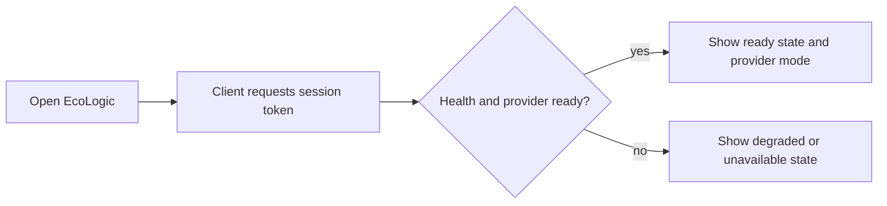
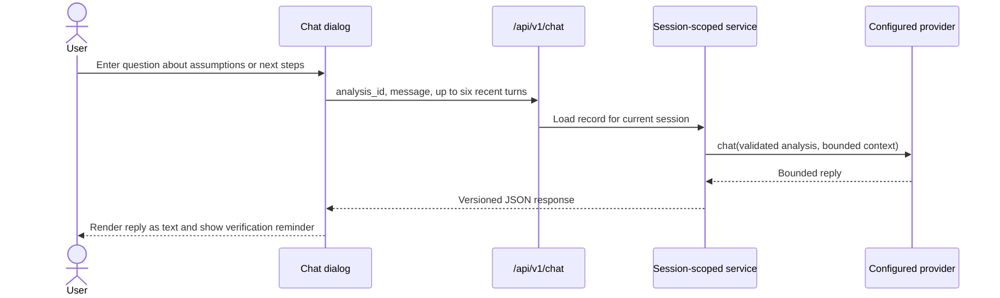

# User flows

> AIONEX EcoLogic v0.2.0 private preview. The default experience uses deterministic demo logic and makes no backend network requests.

EcoLogic is designed around one evidence-to-action journey: describe an environmental observation, review a bounded assessment, and use the roadmap as a discussion aid. It is not an emergency, inspection, certification, engineering, legal, or financial service.

## 1. Start a browser session

The page loads self-hosted HTML, CSS, fonts, JavaScript, and artwork. The client requests `/api/v1/session` to establish a signed browser session and obtain a CSRF token, then reads `/api/v1/health` for a truthful readiness indicator. In default configuration the provider badge identifies demo mode.

The session is anonymous. It is not an AIONEX account and should not be treated as durable identity.

## 2. Submit an environmental observation

1. Enter a written environmental description. The UI suggests including location, timing, scale, and recent changes and warns against personal or confidential information.
2. Optionally choose a JPEG, PNG, or WebP image up to 2 MB. The browser previews and validates the file; the server independently checks MIME type, base64 encoding, decoded size, and file signature.
3. Optionally use browser voice recognition to draft text. This is a browser/vendor feature and may send audio to that vendor; it is separate from the backend provider.
4. Select **Assess observation**.
5. The client sends the description, inferred locale, and optional image to `/api/v1/analyses` with the session CSRF token.

A nonempty environmental description is mandatory even when an image is attached. Demo mode does not inspect pixels, so every visually relevant detail must be described in text. Image-only and out-of-scope requests fail without creating history.

### Successful assessment

The results workspace displays:

- provider/evidence mode;
- category and status;
- aggregate risk and three risk components;
- contributing factors and confidence note;
- financial-potential and ISO-reference fields that explicitly say when they were not assessed;
- an optional current-score context view that explicitly states no forecast, target, trend, probability, or severity threshold was generated;
- exactly six recommended roadmap steps;
- a decision-support disclaimer.

The browser focuses the result area and announces completion through an accessible live region. The result is also available in the same session's saved assessments.

### Consultation versus forensic result

- Advisory requests such as “How can a small office reduce avoidable waste?” produce a consultation with zero aggregate/component risk and an improvement roadmap.
- Damage or hazard observations such as a recurring water leak produce a nonzero forensic-style review and a roadmap that begins with immediate hazard isolation.

These are deterministic demo classifications, not verified site findings.

### Failure and retry

The form preserves the last bounded payload in browser memory. Typed server failures become a visible error panel with retry and dismiss actions. Validation, CSRF, unsupported topic, rate limit, provider, and service failures have distinct API codes, while the UI presents concise user-facing guidance.

## 3. Work through the roadmap

Each roadmap item has a checkbox and optional detail disclosure. Checking items updates an in-page progress indicator. When all items are checked, the interface can acknowledge completion.

Completion state is not persisted. Reloading the page or opening a saved assessment resets the checklist. Marking a step complete is not proof that work occurred and does not change the stored assessment.

## 4. Request a plain-language explanation

1. Complete or open an assessment.
2. Select **Explain this assessment**.
3. The client sends only the stored `analysis_id` to `/api/v1/coach`.
4. The server reloads that assessment using the current session scope and asks the configured provider for a bounded explanation, tip, and confidence note.

The coach cannot operate on another browser session's record, and client JSON cannot substitute an assessment payload. The explanation does not alter the assessment.

## 5. Ask a follow-up question

Chat is available only after an assessment is loaded. The browser retains at most the recent bounded context it sends; the application database does not store chat transcripts. Demo replies are deterministic and limited. They are not a general-purpose assistant or emergency channel.

## 6. Reopen or delete saved assessments

Open **Saved assessments** to request the current session's recent history. Each item shows a category, risk, minimized text excerpt, and a browser-local date/time derived from the stored UTC timestamp.

- Selecting an item renders its stored validated result and resets transient roadmap/chat state.
- Selecting delete opens a confirmation dialog. Confirming sends a CSRF-protected DELETE for that record.
- The API also supports clearing the current session's history, although the v0.2.0 browser interface exposes individual deletion.

History is scoped to the signed browser session, retained for up to 30 days by default, and limited in list size. Clearing cookies can make existing rows inaccessible to that browser before they expire. Deleting a visible row is not a guarantee of forensic erasure from WAL files, backups, snapshots, or third-party logs.

## 7. Unsupported and unsafe expectations

EcoLogic refuses text outside its environmental/sustainability scope. It should not be used to:

- certify ISO compliance;
- predict savings or environmental outcomes;
- clear equipment or a site as safe;
- replace emergency response or a qualified professional;
- identify people or process confidential/personal data;
- infer environmental meaning from an image without a written description.

## Accessibility and responsive behavior

The primary flows use native controls, explicit labels, a skip link, keyboard-operable dialogs, focus restoration, live status regions, error roles, visible focus styling, and text-based status in addition to color. The two-column workspace collapses for smaller viewports. Accessibility is an ongoing quality requirement; the private-preview implementation is not presented as a formal conformance certification.
